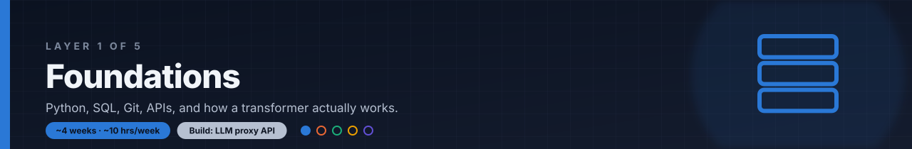

# Layer 1: Foundations

**Time budget:** ~4 weeks at ~10 hrs/week

## Why this layer exists

Read a few AI engineer job posts and the same basics show up every time: Python, SQL, Git, and building or calling web APIs. These are table stakes. Nobody will teach them to you on the job.

You do not need to train a model from scratch to build with LLMs. You do need a working picture of what happens inside one: text becomes tokens, tokens become vectors (embeddings), attention mixes them, and settings like temperature change what comes out. That picture is what lets you debug a bad answer later instead of guessing.

This layer gets you both: the everyday engineering tools and just enough model intuition.

## After this layer you can

- Write async Python that calls an HTTP API and handles slow or failed responses.
- Query a SQLite or Postgres database with joins and aggregates.
- Work in a Git repo with branches and pull requests.
- Build a small FastAPI service with typed request and response models.
- Explain tokens, embeddings, attention, and temperature in plain words.

## Topics

**Python**

- [ ] Virtual environments (`venv`) and installing packages with `pip`
- [ ] Type hints for functions and data (`str`, `list[int]`, `dict`, optional values)
- [ ] `async` / `await`: what an event loop is and why it helps when waiting on network calls
- [ ] Making HTTP requests with `httpx` (sync and async clients, timeouts); see the [HTTPX async guide](https://www.python-httpx.org/async/)

**SQL**

- [ ] `SELECT`, `WHERE`, `ORDER BY`, `LIMIT`
- [ ] Joins across two or more tables
- [ ] Aggregates: `COUNT`, `SUM`, `AVG`, `GROUP BY`
- [ ] Indexes: what they are and when a query needs one

**Git**

- [ ] Commit, branch, merge, and resolve a simple conflict
- [ ] The pull request flow: push a branch, open a PR, review, merge

**FastAPI & REST**

- [ ] Routes and HTTP methods (`GET`, `POST`) and status codes
- [ ] Request and response models with Pydantic
- [ ] Background tasks (work that runs after the response is sent)
- [ ] Auth headers and API keys kept in environment variables, not in code
- [ ] Rate limits, and retrying failed calls with exponential backoff

**LLM intuition**

- [ ] Tokens: how text is split up, and why token counts drive cost and limits
- [ ] Embeddings: words and passages as vectors, where similar meaning means nearby vectors
- [ ] Attention: how each token looks at the other tokens to build context
- [ ] Sampling settings: temperature and top-p, and what changes when you raise or lower them

## Resources

- **[The Python Tutorial](https://docs.python.org/3/tutorial/)** — docs · ~10h · The official tour of the language, including virtual environments and packages; focus on chapters 3-9 and 12 (venv).
- **[SQLBolt](https://sqlbolt.com/)** — course · ~3h · Short interactive lessons in the browser that take you from `SELECT` to joins and aggregates.
- **[Pro Git](https://git-scm.com/book/en/v2)** — docs · ~6h · The free official Git book; chapters 1-3 and 6 cover daily use, branching, and GitHub pull requests.
- **[FastAPI Tutorial - User Guide](https://fastapi.tiangolo.com/tutorial/)** — docs · ~8h · Step-by-step official guide to routes, Pydantic models, and background tasks; its "Concurrency and async / await" page is a clear intro to async.
- **[Transformers, the tech behind LLMs (3Blue1Brown)](https://www.youtube.com/watch?v=wjZofJX0v4M)** — video · ~30m · A visual walk through tokens, embeddings, and attention (with a brief look at temperature); for top-p, follow up with Hugging Face's [How to generate text](https://huggingface.co/blog/how-to-generate).

## Mini-project

**LLM proxy API.** Build a small FastAPI service that sits in front of one LLM provider (any provider with a free tier, or a local model). It exposes one async endpoint that forwards a prompt to the model and returns the answer, logs every request to SQLite, and retries failed calls with exponential backoff. Keep it in a Git repo with a README.

**Done when:**

- [ ] A `POST` request to `/chat` returns a model response, and a new row (time, prompt, response, latency) appears in the SQLite log table.
- [ ] When the provider call fails or is rate limited, the logs show retries with growing wait times before the service gives up with a clear error.
- [ ] A SQL query over the log table prints the number of requests and the average latency per day.
- [ ] The code lives in a Git repo with at least one merged branch, and the README explains how to set the API key and run the service.

## Next

Continue to [Layer 2: LLM Engineering](../02-llm-engineering/README.md).
