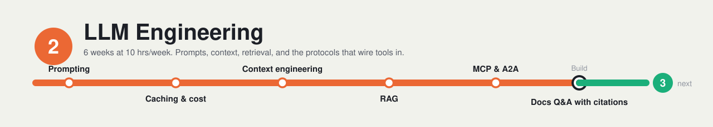

# Layer 2: LLM Engineering

**Time budget:** ~6 weeks at ~10 hrs/week

## Why this layer exists

This is the core of AI engineering in 2026. Most of the work is not training models; it is getting a model that already exists to give reliable, useful answers inside a real product. That means good prompts, output your code can parse, and the right information in front of the model at the right time.

Open a handful of AI engineer job posts and retrieval-augmented generation (RAG) is in most of them: search your own documents, hand the best passages to the model, and get an answer grounded in them. Deciding what goes into the model's context window has become its own discipline, called context engineering. And when you want a model to use your tools and data, the Model Context Protocol (MCP) is the standard way to wire them in.

This layer covers all four: prompting and structured output, caching, context engineering with RAG, and MCP.

## After this layer you can

- Write prompts that return output matching a JSON Schema your code can validate.
- Use prompt caching to cut the cost and latency of long, repeated prompts.
- Decide what belongs in a model's context window and what it should fetch later with tools.
- Build a RAG pipeline with hybrid search and reranking that cites its sources.
- Expose your own tools and data to any LLM app as an MCP server.

## Topics

**Prompting and structured output**

- [ ] System prompts, clear instructions, and a few good examples (few-shot prompting)
- [ ] Separating instructions from data with XML tags or clear sections
- [ ] Structured outputs: making the reply match a JSON Schema, then validating it in code
- [ ] Tool (function) calling: describing a function so the model can ask your code to run it

**Caching and cost**

- [ ] Prompt caching: reusing a stable prefix (system prompt, documents, tool definitions) to cut cost and latency
- [ ] Ordering a prompt so the parts that never change come first and the parts that change come last

**Context engineering**

- [ ] The context window as a limited budget: more tokens is not always better
- [ ] Just-in-time retrieval: giving the model tools to look things up instead of loading everything up front
- [ ] Long tasks: compaction (summarizing old turns) and notes kept outside the context window

**RAG**

- [ ] Embedding models: they turn text into vectors; pick one by quality on your text, languages, and cost, and embed documents and queries with the same model
- [ ] Chunking documents and storing their embeddings in a vector database such as Qdrant, Pinecone, or Weaviate
- [ ] Hybrid search: BM25 keyword scores plus vector similarity, merged with reciprocal rank fusion (RRF)
- [ ] Reranking: a second, slower model re-scores the top results before they reach the LLM
- [ ] Grounded answers: citing the source of each claim, and saying "I don't know" when nothing relevant was found
- [ ] GraphRAG: when a knowledge graph of entities and relationships, stored in a graph database such as Neo4j, beats plain chunk search

**Protocols**

- [ ] MCP: hosts, clients, and servers, and the three things a server offers (tools, resources, prompts)
- [ ] A2A: a protocol for agents talking to other agents, and how it differs from MCP; see the [A2A Protocol site](https://a2a-protocol.org/latest/)

## Resources

- **[Prompting best practices (Anthropic)](https://platform.claude.com/docs/en/build-with-claude/prompt-engineering/claude-prompting-best-practices)** — docs · ~2h · The living reference for clear instructions, examples, XML structure, output formatting, and tool use; for JSON Schema outputs, read OpenAI's [Structured model outputs](https://developers.openai.com/api/docs/guides/structured-outputs) guide, which also explains when to use function calling instead.
- **[Prompt caching (Anthropic)](https://platform.claude.com/docs/en/build-with-claude/prompt-caching)** — docs · ~1h · How cached prompt prefixes work: cache breakpoints, cache lifetimes, pricing, and what invalidates a cache, with worked examples.
- **[Effective context engineering for AI agents (Anthropic)](https://www.anthropic.com/research/effective-context-engineering-for-ai-agents)** — docs · ~30m · Why context is a limited budget and how to spend it: lean prompts and tools, just-in-time retrieval, and compaction, notes, and sub-agents for long tasks.
- **[Hybrid Search with Reranking (Qdrant)](https://qdrant.tech/documentation/tutorials-basics/reranking-hybrid-search/)** — docs · ~2h · A hands-on tutorial that combines dense vectors with BM25 sparse vectors, merges them with RRF, then reranks with a ColBERT model; it runs on Qdrant Cloud, which has a free tier.
- **[Build an MCP server](https://modelcontextprotocol.io/docs/develop/build-server)** — docs · ~2h · The official tutorial: a short tour of tools, resources, and prompts, then a small weather server (in Python or one of several other languages) connected to a desktop chat app.

## Mini-project

**Docs Q&A with citations.** Pick one open-source project with public docs. Split its docs into chunks and index them twice: once for BM25 keyword search and once for vector search. Merge the two result lists, rerank the merged list, and have the model answer only from the top chunks, citing the docs page behind each answer. Wrap it all in an MCP server with one tool, `ask_docs`, so any MCP client can use it.

**Done when:**

- [ ] Calling `ask_docs` from an MCP client with a question about the project returns an answer plus at least one citation to a docs page that actually contains the answer.
- [ ] For a question that uses an exact name (a function, flag, or config key), the logs show the BM25 results, the vector results, and the reranked final list.
- [ ] A question the docs do not cover returns "I don't know" (or equivalent) instead of a made-up answer.
- [ ] The README names the project and docs version indexed, and explains how to rebuild the index and connect the server to an MCP client.

## Next

Continue to [Layer 3: Agents](../03-agents/README.md).
