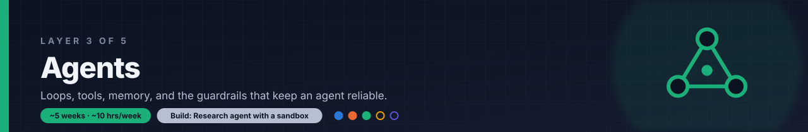

# Layer 3: Agents

**Time budget:** ~5 weeks at ~10 hrs/week

## Why this layer exists

Agents are one of the biggest shifts in 2026 AI engineer job posts. A year or two ago, "has built an agent" was a nice extra on a CV. Now many posts list building agents as a core requirement: a model that calls tools in a loop, keeps track of what it has done, and works toward a goal over many steps.

Getting an agent to work once, in a demo, is easy. The hard part is reliability: an agent that picks the wrong tool, loops forever, burns through a budget, or runs unsafe code is worse than no agent at all. Most of the real work is in the guardrails: clear tools, step and cost limits, sandboxes, and a human who can step in.

This layer covers how agents are designed, the main frameworks for building them, running their code safely, and two growing kinds of agent: voice and browser.

## After this layer you can

- Decide when a task needs an agent and when a fixed workflow of LLM calls is enough.
- Build a tool-using agent loop in LangGraph with memory and a human approval step.
- Run model-written code in an isolated sandbox instead of on your own machine.
- Stop a runaway agent with step caps, token budgets, and clear failure handling.
- Explain how voice agents and browser agents differ from text-only agents.

## Topics

**Agent design**

- [ ] Workflows vs agents: fixed code paths around LLM calls vs a model that chooses its own next step
- [ ] The ReAct loop: the model reasons, picks an action (a tool call), reads the result, and repeats until done
- [ ] Tool use: letting the model call your functions and APIs, and feeding the results back into the conversation
- [ ] Tool schemas: clear names, descriptions, and JSON Schema parameters, since the model only knows a tool through its schema
- [ ] Planning: breaking a goal into steps first, then executing and revising the plan as results come in
- [ ] Orchestrator-workers: one planner agent hands sub-tasks to worker agents and combines their results

**Memory**

- [ ] Short vs long-term memory: the current conversation and scratch state (short-term) vs facts saved across sessions in a store the agent can search (long-term)

**Frameworks**

- [ ] LangGraph: agents as a graph of steps with shared state, checkpoints, and pauses for human input
- [ ] CrewAI: teams of agents ("crews") with set roles and tasks, plus event-driven "flows" for more control
- [ ] AutoGen: Microsoft's multi-agent conversation framework; Microsoft has now archived it and points new users to [Microsoft Agent Framework](https://github.com/microsoft/agent-framework), while the community fork continues as AG2

**Safety and reliability**

- [ ] Sandbox execution (E2B, Modal): running model-written code in a throwaway, isolated machine with time limits
- [ ] Human-in-the-loop: pausing before risky actions (sending email, spending money, deleting data) until a person approves
- [ ] Failure handling (max steps, budget): step caps, token and cost budgets, timeouts, and retries, so a stuck agent stops with a clear error instead of looping

**Voice and browser agents**

- [ ] Voice agents (Whisper, realtime APIs): speech-to-text, then the agent, then text-to-speech, vs one realtime speech-to-speech model; latency is the main constraint
- [ ] Browser agents: agents that read web pages and click, type, and navigate to finish tasks on sites that have no API

## Resources

- **[Building effective agents (Anthropic)](https://www.anthropic.com/research/building-effective-agents)** — docs · ~45m · Defines workflows vs agents, walks through the main patterns (prompt chaining, routing, parallelization, orchestrator-workers, evaluator-optimizer), and advises starting simple, with stopping conditions and sandbox testing; an appendix covers tool design.
- **[Introduction to LangGraph (LangChain Academy)](https://academy.langchain.com/courses/intro-to-langgraph)** — course · ~6h · A free video course: state and memory, human-in-the-loop, parallel steps and sub-graphs, building a research assistant, long-term memory, and deployment.
- **[Running your first Sandbox (E2B)](https://docs.e2b.dev/quickstart)** — docs · ~1h · Gets an API key, creates a cloud sandbox from Python or JavaScript, runs code in it, and lists its files; new accounts get free credits. For a second option with timeouts, snapshots, and lifecycle controls, read Modal's [Sandboxes guide](https://modal.com/docs/guide/sandbox).
- **[Voice agents (OpenAI)](https://developers.openai.com/api/docs/guides/voice-agents)** — docs · ~1h · Compares three designs (full-duplex GPT-Live, speech-to-speech with the Realtime API, and a chained speech-to-text, agent, text-to-speech pipeline), with build steps for each and how to measure latency; API use is paid, so for free local transcription try the open-source [Whisper](https://github.com/openai/whisper) models.
- **[browser-use](https://github.com/browser-use/browser-use)** — repo · ~2h · An MIT-licensed Python library for browser agents; the README covers install, a first agent script, adding custom tools, and running with a local model. To give any MCP client a browser instead, see [Playwright MCP](https://github.com/microsoft/playwright-mcp).

## Mini-project

**Research agent with a sandbox.** Build an agent that takes a research question and returns a short written report with citations. A planner agent splits the question into sub-tasks and hands them to two worker agents: one searches and reads web sources, the other writes and runs code (for example, to compute or chart numbers) inside a sandbox such as E2B or Modal, never on your own machine. The planner combines their results into a report that cites a source for every claim. Set a hard step cap and a hard token budget for the whole run, and log every step.

**Done when:**

- [ ] A run on a real question produces a report in which every factual claim has a citation to a source URL the agent actually opened.
- [ ] The run log shows the planner handing tasks to both workers, and shows code from the code worker running inside the sandbox, with its output.
- [ ] With the step cap set very low, the run log shows the agent stopping at the cap with a partial report rather than hanging.
- [ ] The log prints total steps and tokens used for each run, and the README explains how to set the step cap, the token budget, and the sandbox API key.

## Next

Continue to [Layer 4: Evaluation](../04-evaluation/README.md).
