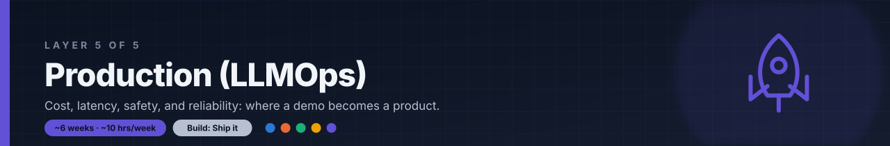

# Layer 5: Production (LLMOps)

**Time budget:** ~6 weeks at ~10 hrs/week

## Why this layer exists

A demo is not a product. A demo runs once, on your laptop, with you typing friendly questions. A product runs thousands of times a day for strangers, some of whom will try to break it, and every call costs money and makes someone wait.

Production is where cost, latency, safety, and reliability get decided. Which model answers which request, how many tokens each call may use, what happens when someone hides instructions in a web page your agent reads, how you roll out a new prompt without breaking every user at once: none of this shows up in a demo, and all of it decides whether people keep using what you built.

Fine-tuning is in this layer on purpose, and it comes last. Train a model only after your evals from Layer 4 show that better prompts, better retrieval, and a better choice of model have stopped helping. This layer covers fine-tuning, faster and cheaper inference, cost and latency engineering, security and red teaming, and shipping and watching a live system.

## After this layer you can

- Decide, with eval numbers, whether a problem needs fine-tuning or better prompting and retrieval.
- Fine-tune an open model with LoRA or QLoRA and compare it with the base model on your golden set.
- Serve a model with an inference engine and cut cost and latency with routing, caching, and token budgets.
- Defend an LLM app against prompt injection with guardrails, and red-team it before users do.
- Deploy behind a canary, monitor cost and latency, and run evals in CI on every change.

## Topics

**Fine-tuning (last, not first)**

- [ ] When NOT to fine-tune: if prompting, RAG, or a stronger model fixes the problem, do that; fine-tune only when evals show those have plateaued and you have enough good examples to train on
- [ ] SFT (supervised fine-tuning): train on input and ideal-output pairs so the model copies a format, tone, or skill
- [ ] DPO (direct preference optimization): train on pairs of a preferred and a rejected answer, without a separate reward model
- [ ] RFT (reinforcement fine-tuning): the model tries answers, a grader scores them, and training pushes toward higher scores; useful when you can grade answers but cannot write the ideal one
- [ ] LoRA and QLoRA: train small adapter matrices instead of every weight (LoRA), on top of a base model loaded in 4-bit (QLoRA), so fine-tuning fits on one GPU

**Inference optimization**

- [ ] Inference optimization and batching: serving open models with an engine such as vLLM that manages GPU memory and groups requests so the GPU works on many at once; continuous batching adds new requests as others finish
- [ ] Quantization: storing weights in fewer bits (8-bit, 4-bit) to use less memory and run faster, at some cost in quality you should measure
- [ ] Caching tiers: exact-match response cache, semantic cache for similar questions, and prompt (prefix) caching inside the provider or engine

**Cost and latency engineering**

- [ ] Cost/latency engineering: measuring cost per request, time to first token, and total latency, and setting targets for each
- [ ] Model routing: sending easy requests to a small, cheap model and hard ones to a large model, based on rules or a classifier
- [ ] Token budgets: capping input and output tokens per request, per user, and per day, so one bad loop or user cannot run up the bill

**Security and red teaming**

- [ ] Guardrails: checks on what goes into and comes out of the model, such as topic filters, PII redaction, output schema checks, and tool allowlists
- [ ] Prompt-injection defense: treating every piece of untrusted text (user input, web pages, files, tool results) as data, limiting what tools the model can call, and asking a human before risky actions
- [ ] AI red teaming: attacking your own app on purpose with injection, jailbreak, and data-leak prompts, automated where you can, before release and after every big change

**Shipping and operating**

- [ ] Deployment: running the app as a service with secrets, timeouts, retries, rate limits, and autoscaling, on a GPU host or behind a model API
- [ ] Canary deploys: sending a small share of traffic to a new prompt, model, or version, comparing its metrics with the old one, and rolling back if it is worse
- [ ] Monitoring: dashboards and alerts for cost, latency, error rate, guardrail hits, and eval scores on live traffic
- [ ] CI/CD: every change runs tests, evals, and red-team prompts before it can deploy

## Resources

- **[PEFT Integration (Hugging Face TRL)](https://huggingface.co/docs/trl/peft_integration)** — docs · ~2h · How to train LoRA adapters with TRL's SFT, DPO, and GRPO (reinforcement learning) trainers, then QLoRA with a 4-bit base model, with suggested learning rates and how to save, load, and merge adapters; for what each trainer does, start at the [TRL overview](https://huggingface.co/docs/trl/index).
- **[vLLM documentation](https://docs.vllm.ai/en/latest/)** — docs · ~3h · The docs for an open-source inference engine; the home page lists its main speed features (PagedAttention, continuous batching, prefix caching, speculative decoding) and supported quantization formats, and the guides cover installation and its OpenAI-compatible server.
- **[Latency optimization (OpenAI)](https://developers.openai.com/api/docs/guides/latency-optimization)** — docs · ~45m · Seven principles, most of which apply to any provider: process tokens faster, generate fewer tokens, use fewer input tokens, make fewer requests, parallelize, make users wait less, and don't default to an LLM, with a worked example; the companion [Cost optimization](https://developers.openai.com/api/docs/guides/cost-optimization) guide adds the Batch API and flex processing for cheaper, slower jobs.
- **[OWASP Top 10 for LLM Applications 2025](https://genai.owasp.org/llm-top-10/)** — docs · ~3h · A free, community-written list of ten LLM app risks, from prompt injection and system prompt leakage to excessive agency and unbounded consumption; each entry explains the risk, ways to prevent it, and example attacks. To automate attacks against your own app, read promptfoo's [LLM red teaming guide](https://www.promptfoo.dev/docs/red-team/).
- **[Run OpenAI-compatible LLM inference with vLLM (Modal)](https://modal.com/docs/examples/vllm_inference)** — docs · ~2h · A complete example that serves an open model with vLLM on a cloud GPU, deploys it with one command, tests it with a client script, and links a Locust load test; Modal's Starter plan includes $30 of free compute per month (at the time of writing). To monitor it, see vLLM's [production metrics](https://docs.vllm.ai/en/latest/usage/metrics/) page: time to first token, end-to-end latency, KV cache usage, and queued requests.

## Mini-project

**Ship it.** Take the research agent from the [Layer 3 mini-project](../03-agents/README.md) and turn it into a service other people can use. Deploy it behind guardrails: input checks, a tool allowlist, a per-request token budget, and output checks before anything is returned. Log every request's tokens, cost, and latency to a cost dashboard. Then red-team it: write 20 prompt-injection attacks, including some hidden in web pages the agent will read, run them all, and record which ones succeed. Fix the top 3 findings and run the attacks again. Finally, add the eval suite and CI job from [Layer 4](../04-evaluation/README.md), pointed at the agent, so every commit runs your evals and the 20 attacks before it can deploy.

**Done when:**

- [ ] The agent answers requests at a deployed URL, and the README lists each guardrail and the token budget with what happens when a request breaks them.
- [ ] A dashboard shows tokens, cost, and latency for each request, plus totals, across at least 50 runs.
- [ ] A red-team report lists all 20 attacks with pass or fail before and after your fixes, and the top 3 findings now fail to get through.
- [ ] CI runs the evals and the 20 attacks on every commit, and a commit that removes a guardrail fails the build.

## Next

Continue to [Careers: where each layer leads](../careers/README.md).
