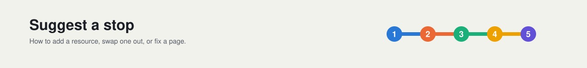

# Contributing



Thanks for helping keep this roadmap short and trustworthy. Open an issue with the **Suggest a resource** template, or send a PR.

## The resource bar

A resource must be:

- **Free** (a free tier is fine).
- **Primary source preferred** (official docs, the paper, the author's repo).
- **Published or updated in 2024 or later**, unless it is a classic.
- **Verified live** when you submit it.

Each layer holds **at most 5 and at least 3** resources. If a layer is full, adding a 6th means proposing a swap: say which existing resource it replaces and why.

## Resource line format

Pattern: bold linked title, then em dash, then `type · ~time · one line why.`

`type` is one of `docs`, `course`, `video`, `paper`, `repo`. Example:

```
- **[Attention Is All You Need](https://arxiv.org/abs/1706.03762)** — paper · ~1h · The original transformer paper.
```

## Before opening a PR

Run the link checker and make sure every line is `OK`:

```
scripts/check-links.sh
```

Output is `STATUS<TAB>FILE<TAB>URL`; statuses are `OK`, `DEAD`, `SOFT404`, `MISSING`.

## License

Contributions are released under [CC BY 4.0](LICENSE).

## Images

Every image under `assets/` is generated by `scripts/make-assets.py` (standard library only). Edit the data in that script, run `python3 scripts/make-assets.py`, and commit the regenerated SVGs. The layer-to-title grid reads its marks from `careers/README.md`, so edit the table there, not the script.
