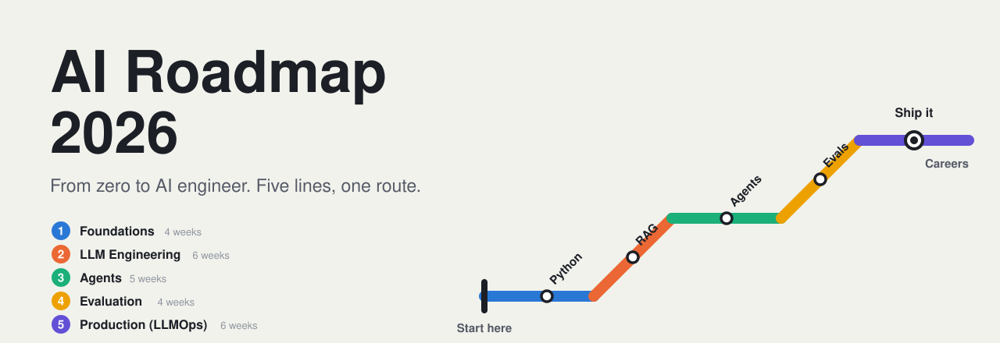
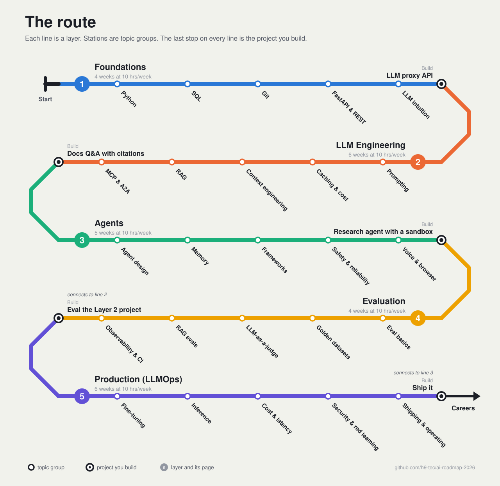

# AI Roadmap 2026

  

  
  
  
  
  

Per the [market analysis](careers/README.md#sources) this roadmap is built on, AI engineering in 2026 shifted from "train models" to "build reliable agentic systems" on top of models that already exist. The same analysis finds three skills repeated in every job description: RAG, Agents, and Evals. Per LinkedIn Jobs on the Rise 2026, AI Engineer is the fastest-growing job in the US, with 143% growth. This roadmap takes a beginner through those skills in five layers, each ending in a mini-project you can show. For job titles and the rest of the numbers, see [Careers](careers/README.md).

  

> If you only learn one thing in 2026, make it evaluation engineering. Start with [Layer 4: Evaluation](04-evaluation/README.md).

## How to use

New here? Read [Start here](00-start-here.md) first.

Then pick one of two paths:

- **Layer by layer.** Pick a layer, finish its mini-project, and move on to the next.
- **On a schedule.** Follow the [12-week sample plan](00-start-here.md#12-week-sample-plan).

Each layer budget assumes ~10 hrs/week. At that pace the five layers take about 25 weeks.

| Layer | Weeks | Mini-project |
|---|---|---|
| [1. Foundations](01-foundations/README.md) | ~4 | LLM proxy API |
| [2. LLM Engineering](02-llm-engineering/README.md) | ~6 | Docs Q&A with citations |
| [3. Agents](03-agents/README.md) | ~5 | Research agent with a sandbox |
| [4. Evaluation](04-evaluation/README.md) | ~4 | Eval the Layer 2 project |
| [5. Production (LLMOps)](05-production/README.md) | ~6 | Ship it |

## More

- [Careers](careers/README.md): which job titles each layer leads to.
- [Resources](resources.md): every resource in one list.
- [Contributing](CONTRIBUTING.md): how to suggest a resource or fix.

## License

Content is licensed under [CC BY 4.0](LICENSE).
